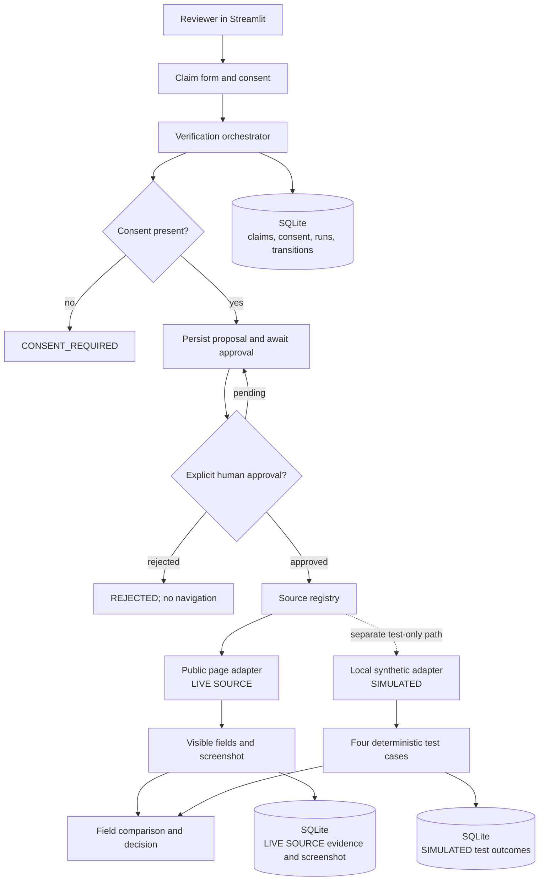

# Certificate Authenticity Checker

A Streamlit demonstration for reviewing certificate claims, human approvals,
field comparisons, and source evidence. It is not a production identity or
credential-verification service.

> **Use synthetic data only.** Do not submit real candidate, personal, or
> confidential information. Sample records and test results are synthetic and
> explicitly labelled. A `VERIFIED` result is limited to the evidence and
> comparison rules shown in the app; it is not a guarantee of authenticity.

## Project files and dependencies

- `app.py` — Streamlit entry point and review dashboard.
- `agent/` — approval-gated orchestration, persistence, simulated source, and
  dashboard queries.
- `sources/public_page.py` — separately labelled `LIVE SOURCE` Playwright
  adapter for an explicitly allowlisted public HTTPS page.
- `requirements.txt` — runtime Python dependencies for Community Cloud.
- `requirements-dev.txt` — runtime dependencies plus pytest.
- `packages.txt` — Chromium system package used by the optional live page adapter.

The app uses only Python standard-library modules plus Streamlit and Playwright.
SQLite is included with Python. Pytest is a development dependency and is not
installed for the deployed app.

## Run locally

Run commands from this project directory, which keeps relative paths consistent
with Community Cloud's repository-root working directory:

```bash
python -m venv .venv
```

On macOS/Linux:

```bash
. .venv/bin/activate
python -m pip install -r requirements-dev.txt
python -m streamlit run app.py
```

On Windows PowerShell:

```powershell
.\.venv\Scripts\Activate.ps1
python -m pip install -r requirements-dev.txt
python -m streamlit run app.py
```

The app creates `data/demo.sqlite3` on startup and safely seeds synthetic demo
records if they are absent. Set `CERTIFICATE_CHECKER_DB_PATH` to override the
relative database path. Do not commit the generated database; `data/` is ignored
by Git.

## Deploy from GitHub to Streamlit Community Cloud

1. Push this project directory to a GitHub repository. Keep `data/`, `.venv/`,
   local evidence, `.env` files, and secrets out of Git. Review the staged files
   and repository history for real candidate data or credentials before pushing.
2. In Streamlit Community Cloud, choose **Create app**, select the GitHub
   repository and branch, and set the app entrypoint to `app.py` if this
   directory is the repository root. If the project is a subdirectory, use its
   repository-relative path, such as `certificate-authenticity-checker/app.py`.
3. Select Python 3.12 in Advanced settings (or another currently supported
   version that you have tested). Community Cloud reads `requirements.txt` and
   `packages.txt` to install Python and system dependencies.
4. Leave `PUBLIC_PAGE_ALLOWED_HOSTS` unset for a simulation-only deployment.
   The app starts without credentials or secrets. To enable the live adapter,
   configure an explicit comma-separated hostname allowlist through the
   `PUBLIC_PAGE_ALLOWED_HOSTS` environment setting, or the optional Streamlit
   setting of the same name. Do not add credentials to the allowlist setting.
5. Deploy, open the generated app in Cloud, and complete the checklist below.
   A URL is assigned by Streamlit after deployment; this repository does not
   claim that deployment has happened.

Streamlit Community Cloud runs the app from the repository root and installs
dependencies declared alongside the app entrypoint. See the official guides for
[file organization](https://docs.streamlit.io/deploy/streamlit-community-cloud/deploy-your-app/file-organization),
[app dependencies](https://docs.streamlit.io/deploy/streamlit-community-cloud/deploy-your-app/app-dependencies),
[deployment](https://docs.streamlit.io/deploy/streamlit-community-cloud/deploy-your-app/deploy), and
[secrets management](https://docs.streamlit.io/deploy/streamlit-community-cloud/deploy-your-app/secrets-management).

## Storage and restart behavior

The default SQLite database path is relative (`data/demo.sqlite3`), so startup
does not depend on a developer's absolute machine path. Community Cloud's local
container filesystem is not durable application storage: SQLite records and
screenshots stored in the local database or as local files may not persist
reliably across app restarts, rebuilds, or replacement of the running
container. Treat claims, approvals, evidence, and test history as temporary.
Startup recreates the schema and reseeds synthetic demo records, so the app
remains usable after a restart even when prior local data is gone. Do not use
this SQLite setup as a durable or multi-user system; use an external persistent
database/object store before relying on long-term records.

## Architecture



Live navigation occurs only after consent, a persisted human approval, and an
atomic execution claim. The app shows the exact destination URL in Approval
Review before navigation. The public-page adapter accepts only an explicitly
allowlisted HTTPS hostname that resolves to public IP addresses. It does not
bypass login, CAPTCHA, OTP, or anti-bot controls. The simulated adapter is a
separate local test path and never creates issuer screenshots.

## Test cases

The **Test Case Dashboard** runs against labelled local synthetic records only.
It does not contact live websites.

| Case | Scenario | Expected result |
|---|---|---|
| TC1 | Candidate, course, and completion date match the synthetic record | `VERIFIED` |
| TC2 | Existing synthetic credential has a different candidate name | `MISMATCH`, with the conflicting field explained |
| TC3 | No record exists in the synthetic catalog | `NOT_FOUND`, never `FAKE` |
| TC4 | Candidate consent is absent | `CONSENT_REQUIRED`, with zero source adapter calls |

Every stored test input, result, and evidence reference is labelled `SIMULATED`.
Live page captures and screenshots are labelled `LIVE SOURCE` and are never
presented as synthetic test evidence.

Run tests locally from the project root:

```bash
python -m pip install -r requirements-dev.txt
python -m pytest
```

The optional Playwright smoke test requires a running app and `APP_URL`. For a
local installation, install the browser with `python -m playwright install chromium`.

## Limitations

- Public-page extraction recognizes visible, explicitly labelled text. It is
  not a general document parser and may return `NEEDS_REVIEW` when a page uses a
  different layout or omits required fields.
- HTTP success or page loading alone never proves authenticity. Missing evidence
  is inconclusive; `NOT_FOUND` is not a `FAKE` classification.
- Cloud SQLite and locally stored screenshots are temporary, may reset, and are
  not suitable for durable audit records or concurrent production usage.
- The demonstration approval identity is not an authenticated user account.
  Anyone with access to the app may be able to submit or approve actions.
- Candidate claims are saved to SQLite. Use only synthetic details in this
  demonstration and do not upload sensitive documents.
- Live source access is disabled unless a hostname allowlist is configured.
  The configured issuer page must be publicly accessible without bypassing
  access controls.

## Final manual verification checklist

- [ ] Confirm the intended GitHub repository and branch contain this project and
      do not contain local databases, screenshots, secrets, or real candidate data.
- [ ] In Community Cloud, select the correct repository, branch, Python version,
      and repository-relative `app.py` entrypoint.
- [ ] Confirm the build installs `requirements.txt` and `packages.txt` without
      errors in Cloud logs.
- [ ] Open the app after the first deployment and after a restart; confirm the
      dashboard renders and synthetic demo records are present.
- [ ] Run all four simulated test cases and confirm each result is labelled
      `SIMULATED`.
- [ ] Submit a synthetic claim without consent and confirm it reaches
      `CONSENT_REQUIRED` without source activity.
- [ ] Submit a consented synthetic claim; confirm the exact destination is
      visible in Approval Review and no navigation happens while pending.
- [ ] Reject one proposed action and confirm no lookup occurs.
- [ ] If live checks are intentionally enabled, configure only an approved
      public hostname, verify it is HTTPS and allowlisted, then approve one
      synthetic claim and check the captured fields, screenshot, timestamp, and
      `LIVE SOURCE` labels.
- [ ] Download JSON and CSV evidence reports and confirm their run IDs, source
      URLs, timestamps, evidence types, and reasons are readable.
- [ ] Confirm the privacy notice is visible and do not use real personal data.
